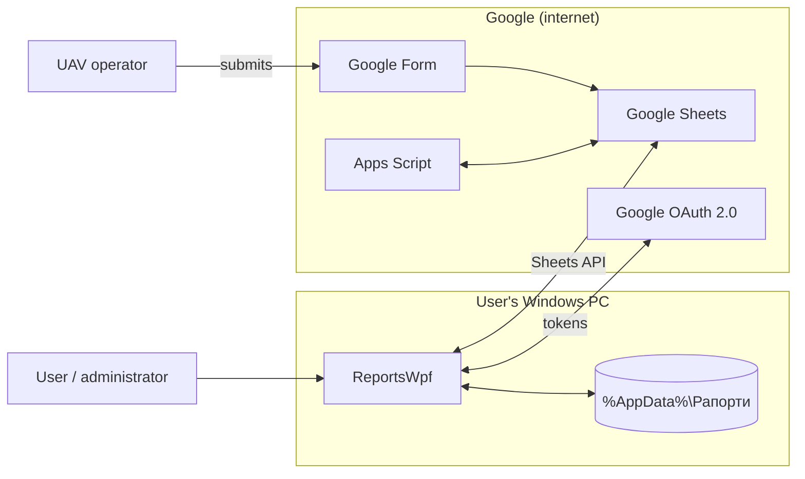
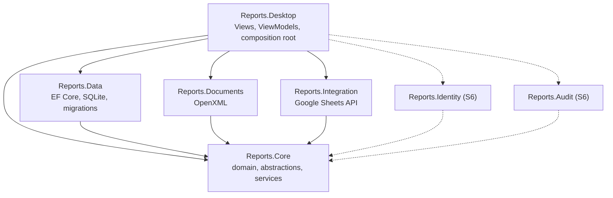
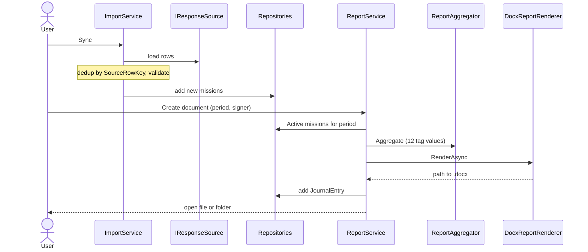

# Architecture Description: ReportsWpf

| Field | Value |
|---|---|
| Project | ReportsWpf, UAV and Ammunition Usage Reporting System |
| Document | Architecture Description (ISO/IEC/IEEE 42010) |
| Version / status / date | 0.1.0, Draft, 2026-09-19 |
| Author | Solomiia Kovalchuk, group IPZs-24-1, KhNU |
| Related | [StRS](../specification/stakeholder_requirements.md), [SRS](../specification/software_requirements.md), [Modules](../specification/modules.md), [Roadmap](../specification/roadmap.md), [Project policy](../policies/project_policy.md) |

The system is not built yet. This document describes the planned architecture. Every element is "Planned" and has a target stage from the [roadmap](../specification/roadmap.md) (S2-S6).

## 1 Introduction

**System of interest.** ReportsWpf is a Windows desktop application (C#, .NET 8, WPF). It takes UAV mission records that operators submit through a Google Form and builds a report in Word format (`.docx`). Data flow: Google Form, Google Sheet, import, deduplication, aggregation, `.docx`, journal.

**Purpose of this document.** Fix the architecture before coding, give a base for the security policy and the STRIDE threat model (Lab 2), and link requirements, modules and decisions.

**Planned solution.** Projects `Reports.Core`, `Reports.Data`, `Reports.Documents`, `Reports.Integration`, `Reports.Desktop` (S2-S5), then `Reports.Identity` and `Reports.Audit` (S6), and test projects in `tests/` (S2).

## 2 Stakeholders and concerns

| Stakeholder | Role | Concerns |
|---|---|---|
| User / administrator | Syncs data, manages reference data, builds reports | Full path from form to report, offline work |
| UAV operator | Fills in the form, does not use the app | Email and mission data stay private |
| Developer | Develops code and docs | Clear layers, tests without UI, database and Google |
| Teacher | Evaluates the lab | Standards, secure design, documented decisions |
| Security owner | Owns data and secrets | Personal data, OAuth token, credentials, audit log |

## 3 Viewpoints

| Viewpoint | Concerns | Model kind |
|---|---|---|
| Context | Scope, external systems, offline mode | Context diagram, interface table |
| Logical / modules | Responsibilities, testability | Component diagram |
| Development / layers | Maintainability | Dependency rules |
| Data | Privacy, integrity | Table of stores and main tables |
| Deployment / runtime | Offline work, secrets | Deployment notes, sequence diagram |
| Security | Privacy, integrity, secrets, audit | Trust boundaries, assets, controls |

## 4 Views

### 4.1 Context

| Interface | Direction | Format | Planned class | Stage |
|---|---|---|---|---|
| Google Sheets, responses and reference data | in | HTTPS, Sheets API v4 | `GoogleSheetsResponseSource` | S4 |
| Google Sheets, reference data and statuses | out | `BatchUpdate`, RAW | `GoogleSheetsWriter` | S4, S6 |
| Google OAuth 2.0 | both | Installed App, system browser | `GoogleAuthenticator` | S4, S6 |

There is also an offline demo mode with fake data (`DemoResponseSource`, default). The switch is `UseDemoData` in settings.

### 4.2 Logical and development view

Dependency rules, checked by architecture tests in CI (S2):
- DR-01: `Reports.Core` has no project or NuGet references.
- DR-02: Data, Documents, Integration, Identity and Audit depend only on Core and not on each other.
- DR-03: abstractions (`I*Repository`, `IReportRenderer`, `IResponseSource`, `IResponseSink`) are declared in Core.
- DR-04: Core does not use the file system directly (`IOutputFolderProvider`, `IReportFileStore`).
- DR-05: `Reports.Desktop` is the only composition root. ViewModels use Core abstractions, not `Google*` types, and no service locator.

### 4.3 Data

All files are under `%AppData%\Рапорти`.

| Artifact | Content | Sensitivity | Planned protection |
|---|---|---|---|
| `reports.db` (SQLite, WAL) | `Missions`, `TargetEngagements`, `MunitionUses`, `UavTypes`, `TargetTypes`, `MunitionTypes`, `Settlements`, `People`, `JournalEntries`; later `Accounts`, `AuditEvents` | High (email, military topic) | Profile rights, encryption decided in Lab 2 |
| `settings.json` | Unit details, `SpreadsheetId`, sheet names, output folder, `UseDemoData` | Medium | No secrets inside |
| `credentials.json` | OAuth client id and secret, put there by the user | High | Not in the repo, DPAPI (S6) |
| `token-rw\` | OAuth access and refresh tokens | High | DPAPI `CurrentUser` (S6) |
| `template.docx`, `*.docx`, `error.log` | Template with `{{tag}}` marks (12 tags), generated reports, error log | Reports: high | Profile rights, log rotation |

- Missions have a stable key `SourceRowKey` (hash of row content, not row number) used for deduplication.
- Status is Active, Cancelled or NeedsAttention. Only Active goes into reports. Records are cancelled, not deleted.
- Reference names are unique in normalized form (also for Cyrillic). The schema changes only through EF Core migrations.

### 4.4 Deployment

- One Windows 10/11 PC, one process `Рапорти.exe`, .NET 8 Desktop Runtime. No server and no Windows service.
- SQLite runs inside the process. Migrations are applied at startup.
- Outgoing HTTPS only to Google (the only incoming connection is the loopback redirect during OAuth consent). Demo mode and local operations work offline.

### 4.5 Runtime: sync, import, report

### 4.6 Security

The formal STRIDE threat model comes in Lab 2 (`docs/security/threat_model.md`). Here is only what is already clear.

**Assets:** missions and reference data, operator email and commander names (personal data), Google token, `credentials.json`, reports, template, journal, accounts and password hashes (S6), audit log (S6).

**Trust boundaries:**
- Google Sheet to app: form answers are untrusted, operators and a script edit the sheet.
- User to app: no login before S6, only the OS protects the profile.
- App to Google Sheet and OAuth: writes, token and scope.
- App to file system: secrets and database are in the user profile.

**Planned controls:**

| Control | Where | Stage |
|---|---|---|
| Input validation (trim, formats, lengths, `UavCount` limit) | Import, UI | S3, S5 |
| RAW writes and escaping of values starting with `=`, `+`, `-`, `@` | `GoogleSheetsWriter` | S4, S6 |
| One-pass tag replacement in `.docx` | `TagReplacer` | S4 |
| Minimal OAuth scope; DPAPI for token and `credentials.json` | `Reports.Integration` | S6 |
| Login, PBKDF2 hash with salt, lockout after 5 failed tries, roles Administrator and Operator | `Reports.Identity` | S6 |
| Audit of who did what and when | `Reports.Audit` | S6 |

## 5 Architecture decisions

| Decision | Reason | Alternatives considered |
|---|---|---|
| Layered architecture: Core / Data / Documents / Integration / Desktop | Core builds and is tested without WPF, database or Google. Dependencies point to Core | One project with folders; full Clean/Onion with Domain and Application projects; feature folders |
| WPF + MVVM + WPF-UI, own `ObservableObject` and `RelayCommand`, `Microsoft.Extensions.DependencyInjection` in the composition root | Good binding and styling on Windows; ViewModels testable without UI; DI makes Identity and Audit easy to add | CommunityToolkit.Mvvm, Prism, ReactiveUI, WinForms, WinUI 3, MAUI, Avalonia, web app, manual wiring |
| SQLite with EF Core and migrations | Local, no server, transactions and indexes; schema can change later without data loss | `EnsureCreated`, JSON or XML files, SQL Server LocalDB, PostgreSQL, Dapper, LiteDB |
| Google Sheets API with OAuth, minimal scope, RAW writes | The source data is already in a Google Sheet; consent without a stored password; RAW stops formula injection | Manual CSV/XLSX import, service account, Apps Script web app, own backend, `USER_ENTERED` writes |
| `.docx` with OpenXML from a template with tags | No Word needed, user can edit the template, works offline | Word Interop (COM), Aspose or Syncfusion, HTML/PDF renderer, whole document built in code |
| Local password authentication with PBKDF2 and two roles | Closes the "anyone in the profile has full access" risk, works offline, built into .NET | No authentication, Windows authentication, Google sign-in, bcrypt/scrypt/Argon2id, `users.json` |

## 6 Risks and open questions

- Before S6 there is no login, so anyone in the Windows profile has full access to the data.
- Token, `credentials.json` and the database are plain files until S6. DPAPI should be enough, to be confirmed in the threat model.
- Open: encrypt `reports.db` (SQLCipher) or rely on NTFS rights. How to recover access if the only Administrator forgets the password.
- Open: an edited sheet row gets a new content hash and is imported as a new mission. A service ID column may be needed.
- Open: narrower OAuth scope such as `drive.file` while still reading a sheet the app did not create. Keep demo mode and add a PDF renderer in release 1.0 or not.
