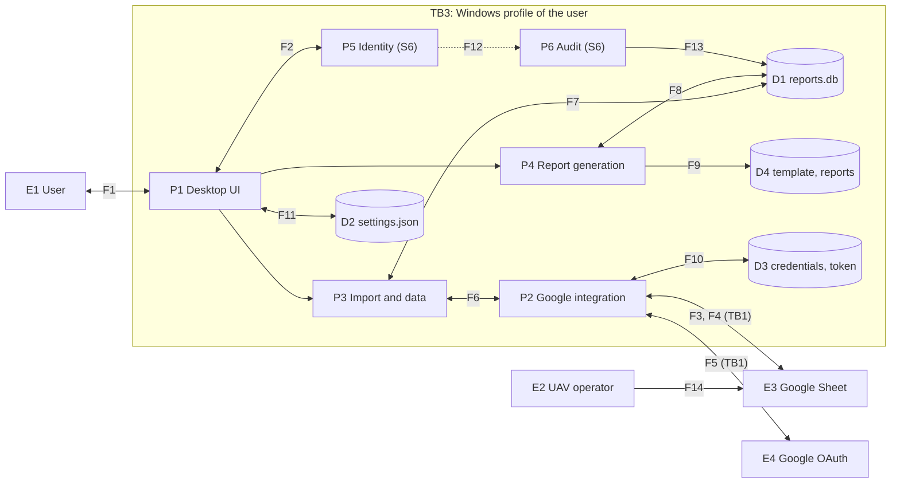

# Threat Model - ReportsWpf

| | |
| --- | --- |
| Name | Threat Model - ReportsWpf (UAV and Ammunition Usage Reporting System) |
| Version | 0.1.0 |
| Status | Draft |
| Classification | Internal |
| Last update | 2026-09-26 |
| Owner | Solomiia Kovalchuk |
| Related documents | [architecture_description.md](../architecture/architecture_description.md), [security_policy.md](security_policy.md), [privacy_policy.md](privacy_policy.md), [software_requirements.md](../specification/software_requirements.md) (section 3.4, SEC-xx) |

## Scope

The project is small, so there is one model for the whole system. The system is not built yet, the model is about the planned design (stages S2 to S6), and it is checked again when the code appears.

The model covers:

- the desktop application `Reports.Desktop` with its layers (UI, import, report generation, settings);
- the local data store `%AppData%\Рапорти`: `reports.db`, `settings.json`, `credentials.json`, `token-rw\`, `template.docx`, generated reports and `error.log`;
- the Google Sheets and OAuth 2.0 integration: reading, publishing, token handling and the data on the wire;
- report generation to `.docx`;
- Identity (login, roles) and Audit (audit log), planned for S6;
- the Git repository and NuGet dependencies, only as a source of leaked secrets and untrusted code.

Out of scope: Google infrastructure itself (Sheets, OAuth server, account security of Google), hardening of Windows, physical security of the PC beyond a locked screen and disk encryption, and the Google Form with its Apps Script (the app only reads what they write to the sheet).

Assumptions: one PC, one Windows profile for the user, Windows updates and antivirus are used, the disk is encrypted (BitLocker), and the owner of the Google data controls who can edit the sheet.

## System Overview

ReportsWpf is a stand-alone Windows application. It imports form answers from a Google Sheet, stores them in SQLite, and builds a `.docx` report for a period. There is no server. Before S6 there is no login, so the Windows profile is the only protection of the data.

| ID | DFD Type | Name |
| --- | --- | --- |
| E1 | External Interactor | User (report writer, later Administrator or Operator) |
| E2 | External Interactor | UAV operator, fills the Google Form, does not use the app |
| E3 | External Interactor | Google Sheet, with the form and Apps Script behind it |
| E4 | External Interactor | Google OAuth 2.0 server |
| P1 | Process | Desktop UI (WPF, ViewModels, role checks) |
| P2 | Process | Google integration (OAuth, read, publish) |
| P3 | Process | Import and data services (episodes, reference data, repositories) |
| P4 | Process | Report generation (aggregation, `.docx` renderer, journal) |
| P5 | Process | Identity (login, password, roles), S6 |
| P6 | Process | Audit (recording and viewing events), S6 |
| D1 | Data Store | `reports.db` (missions, reference data, journal, later `Accounts` and `AuditEvents`) |
| D2 | Data Store | `settings.json` (unit data, `SpreadsheetId`, output folder) |
| D3 | Data Store | `credentials.json` and `token-rw\` (OAuth client and token) |
| D4 | Data Store | `template.docx` and generated reports in the output folder |
| D5 | Data Store | `error.log` |
| D6 | Data Store | Git repository and NuGet packages (outside the runtime) |
| TB1 | Trust Boundary | Application / Google (internet), crossed by F3, F4, F5 |
| TB2 | Trust Boundary | User / application (no login before S6, role checks after) |
| TB3 | Trust Boundary | Application process / files in the Windows profile |
| TB4 | Trust Boundary | Developer / public repository and package sources |

Data flows:

| ID | Flow | Content |
| --- | --- | --- |
| F1 | E1 <-> P1 | Input, period, signer, passwords, reports to open (TB2) |
| F2 | P1 <-> P5 | Login request, session, access checks |
| F3 | E3 -> P2 | Reference lists, people, answers (untrusted, TB1) |
| F4 | P2 -> E3 | New reference items, people, statuses, RAW batch (TB1) |
| F5 | P2 <-> E4 | Consent, authorization code, access and refresh token (TB1) |
| F6 | P2 -> P3 | Raw rows |
| F7, F8 | P3, P4 <-> D1 | Missions, reference data, journal (TB3) |
| F9 | P4 -> D4 | Generated `.docx` (TB3) |
| F10 | P2 <-> D3 | Client secret and token (TB3) |
| F11 | P1 <-> D2 | Settings (TB3) |
| F12, F13 | P1, P5, P3, P4 -> P6 -> D1 | Audit events (TB3) |
| F14 | E2 -> E3 | Form answers, outside the app, shown for context |

### Intruder model

| ID | Actor | Access and capabilities | Goals |
| --- | --- | --- | --- |
| A1 | Unauthorized local user | Sits at the unlocked PC or has another account on it. No admin rights, only normal tools. Can start the app and may read profile files if rights are weak | Read operational data and emails, make or change reports |
| A2 | Malicious or compromised operator | Sends any text through the Google Form, no access to the PC | Add false episodes, break the import, plant formulas or `{{tags}}` in values |
| A3 | Malware on the PC | Runs as the user of the profile: reads and writes the profile files, calls DPAPI as that user, listens on loopback, reads keystrokes | Steal token, database and passwords, change data, destroy files |
| A4 | Person with access to the Google Sheet | Editor of the sheet, owner of Apps Script, or a compromised Google account. Edits rows, statuses, reference lists and people | Change report numbers or the signer, plant bad values, read all answers |
| A5 | Attacker with the leaked repository or credentials | Has a public repo, a leaked client secret or token, no access to the PC | Use the token on the sheet, find real data, bring a bad dependency |
| A6 | Operator account (S6) | Logged in with the lower role | Do administrator actions, hide own actions |
| A7 | Network attacker | Sees and changes traffic on the same network, cannot break TLS | Take the token or the authorization code |

## STRIDE Analysis

Canonical match of STRIDE to element types:

| DFD Element | S | T | R | I | D | E |
| --- | :---: | :---: | :---: | :---: | :---: | :---: |
| External Interactor | ✓ |  | ✓ |  |  |  |
| Data Flow |  | ✓ |  | ✓ | ✓ |  |
| Data Store |  | ✓ |  | ✓ | ✓ |  |
| Process | ✓ | ✓ | ✓ | ✓ | ✓ | ✓ |

Marks: **S** - Spoofing; **T** - Tampering; **R** - Repudiation; **I** - Information Disclosure; **D** - Denial of Service; **E** - Elevation of Privilege. E4 (Google) is out of scope and is not analysed. F1, F2, F6 to F13 stay inside one process or one profile and are covered by the processes and stores they connect.

| Element | S | T | R | I | D | E |
| --- | --- | --- | --- | --- | --- | --- |
| **E1 User** *(External Interactor)* | T-01 Another person works as the user (no login before S6, guessed password). | - | T-02 User denies an action. | - | - | - |
| **E2 UAV operator** *(External Interactor)* | T-03 Forged submission with another operator's email. | - | T-03 Operator denies a submission, only a typed email exists. | - | - | - |
| **E3 Google Sheet** *(External Interactor)* | T-03 An editor or script acts as an operator. | - | - | - | - | - |
| **F3, F4 P2 <-> E3** *(Data Flow)* | - | T-04 Traffic changed on the way. | - | T-04 Traffic or token intercepted. | T-09 Quota error or no network. | - |
| **F5 P2 <-> E4** *(Data Flow)* | - | - | - | T-05 Authorization code taken from the loopback redirect. | - | - |
| **P1 Desktop UI** *(Process)* | - | - | T-02 Actions without a trace. | T-17 Errors show secrets or stack traces. | - | T-11 Operator calls an admin action. |
| **P2 Google integration** *(Process)* | T-05 Fake redirect to the app. | T-07 Formula injection or foreign status overwritten in the sheet. | - | T-17 Token in logs or messages. | T-09 Retries and waits block sync. | T-06 Token with a wide scope. |
| **P3 Import and data** *(Process)* | - | T-08 Malicious or malformed sheet values. | - | - | T-09 Huge sheet blocks import. | - |
| **P4 Report generation** *(Process)* | - | T-10 Tag injection, bad file name. | T-02 Report without an actor. | T-17 Report saved where others read it. | - | - |
| **P5 Identity** *(Process)* | T-12 Password guessing. | T-13 Account row edited in the file. | T-02 Login events missing. | - | T-12 Admin locked out on purpose. | T-11 Role bypass. |
| **P6 Audit** *(Process)* | - | T-13 Audit records edited or deleted. | T-13 Missing records hide actions. | T-17 Secrets in audit details. | - | - |
| **D1 reports.db** *(Data Store)* | - | T-13 Rows edited with a SQLite tool. | - | T-14 Database copied and read. | T-18 Deleted, corrupted or locked. | - |
| **D2 settings.json** *(Data Store)* | - | T-16 `SpreadsheetId` changed to a foreign sheet. | - | - | T-18 Damaged file. | - |
| **D3 credentials, token** *(Data Store)* | - | T-16 `credentials.json` replaced. | - | T-15 Files read by malware. | - | - |
| **D4 template, reports** *(Data Store)* | - | T-16 Template edited, wrong text in reports. | - | T-17 Reports readable or synced to a shared folder. | T-18 Files deleted. | - |
| **D5 error.log** *(Data Store)* | - | - | - | T-17 Log with secrets or personal data. | - | - |
| **D6 Repository, packages** *(Data Store)* | - | T-20 Bad or vulnerable dependency. | - | T-19 Secrets or real data committed. | - | - |

### Threat details

| ID | Element / STRIDE | Actor | Scenario | Mitigation | Requirements ("new" = added to the SRS after this analysis) | Residual risk |
| --- | --- | --- | --- | --- | --- | --- |
| T-01 | E1 / S | A1, A3 | Before S6 anyone at the unlocked PC or in the profile works as the user. After S6 someone knows or guesses a password. | Login before any function, password rules, lockout, screen lock, one account per person | SEC-01, SEC-02, SEC-03 | Medium before S6 (only Windows protects), low after |
| T-02 | E1, P1, P4, P5 / R | A6 | A user cancels episodes, changes settings or makes a report and denies it. Before S6 the journal has no actor. | Audit record with UTC time, actor, action and result, report journal, no shared accounts | SEC-09 | Medium before S6, low after |
| T-03 | E2, E3 / S, R | A2, A4 | Someone sends a form with another operator's email, or edits the sheet as an operator or script. The app cannot prove who typed an answer. | Rows are untrusted and validated, unknown values give Needs attention, wrong rows are cancelled, sheet sharing is controlled by the data owner | SEC-08 | Medium, authenticity of answers is outside the app |
| T-04 | F3, F4 / T, I | A7 | A network attacker changes or reads Sheets traffic or the token exchange (rogue proxy, bad certificate). | HTTPS only through the Google client library, certificate check is never turned off | CON-06, SEC-11 | Low |
| T-05 | F5, P2 / I, S | A3 | Another local process listens on the loopback port of the OAuth redirect and takes the code, or fakes the redirect. | System browser, loopback redirect with state and PKCE from the Google library, no embedded browser | FR-19 | Low |
| T-06 | P2 / E | A3, A5 | A stolen token with scope `spreadsheets` reads and writes all spreadsheets of the Google account. | `spreadsheets.readonly` for import, write scope only when upload is enabled, Forget token and revoke in the Google account | SEC-06 | Medium, Google has no narrower scope for an existing sheet |
| T-07 | P2 / T | A4 | The app writes `=IMPORTXML(...)` from a value into the sheet, or overwrites a status set by someone else. | RAW mode, prefix for values starting with `=`, `+`, `-`, `@`, only changed statuses, expected value check | SEC-07, FR-20 | Low |
| T-08 | P3 / T | A2, A4 | Rows with formulas, `{{tags}}`, very long text, negative or huge counts, bad dates or emails damage the data or reach the report. | Validate email, length, UAV range, date, sheet ID and period, out of range gives Needs attention, values are never tags or formulas | SEC-08, FR-05, FR-06 | Low |
| T-09 | P3, F3 / D | A2, A4 | A sheet with a huge number of rows or cells, an API quota error or no network blocks the sync and the UI. | Limit of rows and cell length with a truncation message, asynchronous calls, retry with backoff, demo mode and local data work offline | SEC-15 (new), NFR-02, NFR-03, FR-23 | Low |
| T-10 | P4 / T | A2, A4 | A signer name or sheet value puts `..\` or a reserved name in the file name, replaces a report, or a `{{...}}` value becomes a tag. | One-pass tag replacement, invalid characters replaced, `CreateNew` with suffix (N), temporary file and atomic rename | FR-16, FR-17, SEC-08 | Low |
| T-11 | P1, P5 / E | A6 | An Operator calls an administrator action (publish, settings, accounts, audit log) through a command that is only hidden. | Role check in the application layer for every protected action, deny by default, denied attempts audited | SEC-04, SEC-09 | Low |
| T-12 | P5 / S, D | A1, A3, A6 | Passwords are guessed, or failed logins are made on purpose to lock the Administrator for 15 minutes. | PBKDF2 with salt, password rules, lockout after 5 tries, same message for every failure, the lock is temporary | SEC-01, SEC-02, SEC-03 | Low, lockout can be a 15 minute nuisance |
| T-13 | P6, D1 / T, R | A1, A3 | Someone edits `reports.db` with a SQLite tool: raises a role in `Accounts`, replaces a hash, changes or deletes `AuditEvents`. Append-only works only inside the app. | Hash chain over audit records with a warning in the audit view, file rights of the profile, export before retention | SEC-13 (new), SEC-09, SEC-12 | Medium, an attacker with file access can still delete or rebuild the database |
| T-14 | D1 / I | A1, A3 | Another user or malware copies `reports.db` and reads emails, commander names and operational data. | Owner-only rights on the data folder, disk encryption from the assumptions, data minimization, no database in the repository | SEC-12, SEC-10 | Medium, see decision below |
| T-15 | D3 / I | A3, A5 | Malware or another user reads `credentials.json` and the token cache and gets the sheet. | DPAPI for both files, minimal scope, Forget token, never written to logs | SEC-05, SEC-06, SEC-12 | Medium, DPAPI does not stop code running as the same user |
| T-16 | D2, D3, D4 / T | A1, A3 | `SpreadsheetId` is changed to a foreign sheet, `credentials.json` is replaced with another OAuth client, or the template is edited. The app imports fake data, publishes to a foreign sheet or prints wrong text. | Settings and template rebuild only for Administrator and audited, sheet title shown and confirmed before the first write and after an ID change, file rights | SEC-14 (new), SEC-04, SEC-09, SEC-12 | Medium |
| T-17 | P1, P2, P4, P6, D4, D5 / I | A1, A3 | Error text, `error.log`, audit details or reports show secrets, stack traces or personal data, or reports lie in a shared or cloud synced folder. | Messages without stack traces, no secrets or content in logs and audit (whitelist), log rotation, default output folder in the profile | SEC-09, SEC-12, NFR-04 | Medium, the user can choose a shared output folder |
| T-18 | D1, D2, D4 / D | A3 | Malware, a disk fault or a mistake deletes or damages the database, settings, template or reports, or another process locks the database. | EF Core migrations, atomic writes, defaults for a broken `settings.json`, missions can be imported again, template can be rebuilt | NFR-05, FR-15, FR-24 | Medium, no backup in 0.1.0, local statuses, journal and accounts are lost |
| T-19 | D6 / I | A5 | `credentials.json`, a token, `reports.db` or real operator data is committed to Git and read by anyone with repository access. | `.gitignore`, secret scan in CI, fictional test data, a leaked secret is rotated and revoked | SEC-10 | Low, history keeps a secret until it is rotated |
| T-20 | D6 / T | A5 | A vulnerable or malicious NuGet package, or a changed `Directory.Packages.props`, brings foreign code into the build. | Central package versions, review of every new package, `dotnet list package --vulnerable` in CI, final check before 1.0 | SEC-11 | Low |

### Results

- Decision on `reports.db` (T-14): the database is not encrypted in 0.1.0. The protection is owner-only rights (SEC-12) and the disk encryption assumed above. SQLCipher stays an option if a shared PC becomes a real use case. The risk is accepted as medium.
- Gaps found, no existing SEC requirement covered them: audit and account tampering (T-13), foreign spreadsheet (T-16) and unlimited sheet size (T-09). They are now SEC-13, SEC-14 and SEC-15 in the SRS.
- Malware under the same Windows user (A3) cannot be stopped by the application. The listed measures only make theft and tampering harder and easier to notice.
