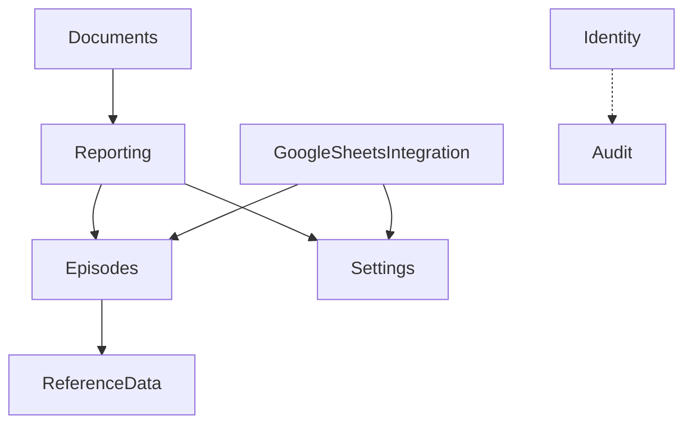

# Module Registry - ReportsWpf

Version 0.1.0, Draft, 2026-09-19. Author: Solomiia Kovalchuk, IPZs-24-1, KhNU.

A module here is a logical boundary of the business area. The code will be split by layers (`Reports.Core`, `Reports.Data`, `Reports.Documents`, `Reports.Integration`, `Reports.Desktop`, and later `Reports.Identity` and `Reports.Audit`), not one project per module. All modules are Planned. Stages are from the [roadmap](roadmap.md).

Related documents: [StRS](stakeholder_requirements.md), [SRS](software_requirements.md), [architecture](../architecture/architecture_description.md), [project policy](../policies/project_policy.md).

| Module | Description | Stage | Depends on |
|---|---|---|---|
| [ReferenceData](modules/ReferenceData/business_logic.md) | Directories (UAV, targets, munitions, settlements) and People (signers, operators). Short and full names, unique names, merge from the source, seed data. | S3 | - |
| [Episodes](modules/Episodes/business_logic.md) | Form submissions (Mission, TargetEngagement, MunitionUse), import, dedup by a stable row key, record statuses. | S3 | ReferenceData, GoogleSheetsIntegration (contract only) |
| [Reporting](modules/Reporting/business_logic.md) | Report periods, aggregation rules (12 tags), report generation flow, journal of generated reports. | S3 | ReferenceData, Episodes, Settings, Documents (contract only) |
| [Documents](modules/Documents/business_logic.md) | `.docx` generation from a template with tags (OpenXML), template builder, tag replacement. | S4 | Reporting, Settings |
| [GoogleSheetsIntegration](modules/GoogleSheetsIntegration/business_logic.md) | Two-way exchange with the Google Sheet: OAuth, reading, appending, status write-back, demo source. | S4 | ReferenceData, Episodes, Settings |
| [Settings](modules/Settings/business_logic.md) | Application settings in `settings.json`: unit data for the template, data source, sheet names, output folder. | S3 | - |
| [Identity](modules/Identity/business_logic.md) | Accounts, login, roles (Administrator, Operator), lockout, password policy, access rules. | S6 | Audit (sends events) |
| [Audit](modules/Audit/business_logic.md) | Append-only log of user actions and security events, query, export, retention. | S6 | Identity (actor), all modules as event sources |

Where two modules depend on each other (Episodes and GoogleSheetsIntegration, Reporting and Documents), the dependency goes through an interface in `Reports.Core`, so the projects do not reference each other.

Shared base: only the abstract `Entity` class (`Id`, `Display`, equality by type and `Id`) in `Reports.Core.Domain`. There is no separate SharedKernel module.
